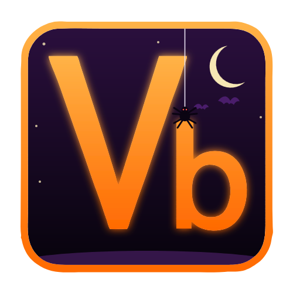

<p align="center">
  
</p>

<h1 align="center">Vbot</h1>

<p align="center">
  A macro bot for Geometry Dash, built as a <a href="https://geode-sdk.org">Geode</a> mod.<br>
  Record in practice mode, replay frame by frame, and render the run to video.
</p>

<p align="center">
  <b>Version</b> 1.0.4-beta &nbsp;·&nbsp; <b>Game</b> 2.2081 &nbsp;·&nbsp; <b>Platforms</b> Windows, Android (64-bit)
</p>

> **Beta.** Recording, replaying and the menu are the core of Vbot. The renderer, the TPS bypass and the position snapshots in macros are new and still being tested, so expect rough edges. If something breaks, please [open an issue](https://github.com/T1fyOwO/Vbot/issues).

---

## What it does

| | |
| --- | --- |
| **Record** | Practice mode only. Build one macro across as many attempts as you like, using checkpoints. |
| **Replay** | Play a saved macro back from frame 0. |
| **Accurate macros** | Always on. Every macro stores snapshots of the player's position (both players in a 2-player level) and replay puts the player back if it has drifted, so long macros stay on track. |
| **Render** | Turns a replay into an `.mp4` with the level's song, through [FFmpeg API](https://geode-sdk.org/mods/eclipse.ffmpeg-api). |
| **Cheats** | Noclip, hitboxes, a TPS bypass and a speed hack. |
| **`.vb` format** | Vbot's own compact macro format. |
| **Full menu** | One popup with Macro, Cheats and Render tabs. Everything you change is saved right away. |

## Install

1. Install [Geode](https://geode-sdk.org) for Geometry Dash 2.2081 (Windows or Android 64-bit).
2. Download the latest `.geode` from the [Releases page](https://github.com/T1fyOwO/Vbot/releases).
3. Open it with Geode (or drop it in Geode's `mods` folder) and restart the game.
4. *Only for rendering:* also install **FFmpeg API** from Geode's in-game mod list. If it's missing, Vbot tells you when you press Render.

## Quick start

1. Open a level and **pause it**. Tap the **Vb** button to open the menu. You can drag the button anywhere you like, and its size and opacity are in the mod settings.
2. Go to the **Macro** tab and type a name for your macro.
3. **Record:** turn on **practice mode**, tap **Record**, restart the level and play. Place checkpoints as you go.
4. Tap **Record** again to stop and save.
5. **Replay:** tap **Replay**, then restart the level to watch it play back.

### How recording works

Recording only works in practice mode, and it keeps going across deaths until you stop it.

- Each checkpoint remembers the frame it was made on.
- When you die and respawn from a checkpoint, the macro is cut back to that frame and recording continues from there. The result is always one clean run, however many attempts it took.
- Dying with **no** checkpoint restarts the macro from the beginning.
- Tapping **Record** again, leaving the level, or turning practice mode off stops recording and saves the macro.

## Rendering

1. Open the level, then on the **Macro** tab pick the macro you want to render.
2. On the **Render** tab set the width, height, FPS, bitrate, codec and output name.
3. Press **Render**, close the menu, and **restart the level**. Rendering starts on the restart.

The game doesn't run in real time while it renders. Every video frame advances the game by exactly 1/FPS seconds, so the result is smooth however long each frame takes. Rendering stops when the macro ends (plus about 2 seconds), about 3 seconds after you complete the level, when you press **Stop**, or when you leave the level.

Videos are saved in `config/t1fy.vbot/Renders`. Vbot never overwrites an earlier render; it adds `_1`, `_2` and so on.

**Audio.** With **Include level audio** on, the level's song is added when the render finishes. For now:

- only songs that start at 0:00 work (Vbot skips audio and tells you if the song starts later),
- sound effects and song triggers aren't included,
- turn the in-game music down while rendering.

**Tips.** Use 16:9 sizes such as 1280x720 or 1920x1080 to avoid a stretched picture. Even numbers only; Vbot rounds odd sizes down.

## The menu

| Tab | What's in it |
| --- | --- |
| **Macro** | Macro name (with previous/next arrows), **Record**, **Replay**, **Stop** and a status line. |
| **Cheats** | **Noclip**, **Hitboxes**, **TPS Bypass** with a TPS box, **Speed hack** with a speed box, and live readouts. |
| **Render** | Width, height, render FPS, bitrate (Mbps), codec, output name, **Include level audio** and the **Render** button. |

### Cheats

Noclip, any TPS other than 240, and any speed other than 1 count as **cheats**. While one is on, finishing a level is treated like a test run, so it won't count or be saved.

- **Noclip:** ignores deaths. The anticheat spike still kills.
- **Hitboxes:** draws the game's own hitboxes in any mode. The readout shows how many vertices were drawn.
- **TPS Bypass:** runs physics at a higher tick rate (240 or higher). More TPS makes physics *more precise*; it doesn't make the game faster. It is experimental and works on **Android 64-bit and Windows** (game 2.2081). Vbot changes the game's own step count with a small patch (only switched on while the bypass is running), so the game itself runs the extra steps. If the patch can't be used, the bypass stays off and tells you why. The Physics readout shows the steps per second the game really ran. On slower phones a very high value can lag; try 480 or 960.
- **Speed hack:** plays the whole game faster or slower (0.1 to 10). It doesn't change the music's speed, and the pause menu keeps its normal speed.

Macros remember the TPS they were recorded at, and Vbot warns you if you replay one at a different TPS.

## Files

Everything lives in Geode's `config/t1fy.vbot` folder:

```
config/t1fy.vbot/
├── Macros/    your .vb macros
└── Renders/   your finished .mp4 videos
```

## Settings

| Setting | What it does | Default |
| --- | --- | --- |
| Button size | Size of the macro button, in pixels | 60 |
| Button opacity | How see-through the button is, in percent | 100 |

Everything else is in the Vbot menu itself.

## The `.vb` format

Vbot saves macros in its own compact binary format. Everything is a plain byte or a varint, so byte order never matters.

```
"VBOT"          4 bytes   magic
version         1 byte    1, 2 or 3
fps             varint    physics ticks per second (240 by default)
event count     varint    number of inputs that follow
events          count x varint
snapshot count  varint    version 3 only
snapshots       count x ( delta varint, mask byte, 12 bytes per player in the mask )   version 3 only
```

Each event is one varint:

```
(delta << 4) | (button << 2) | (down << 1) | player
```

| Field | Meaning |
| --- | --- |
| `delta` | frames since the previous input (the first input counts from frame 0) |
| `button` | `0` jump, `1` left, `2` right |
| `down` | `1` press, `0` release |
| `player` | `0` player 1, `1` player 2 |

A **snapshot** is the state of the player(s) at the start of one physics step:

| Field | Meaning |
| --- | --- |
| `delta` | frames since the previous snapshot (the first one counts from frame 0) |
| `mask` | bit 0: player 1 is included, bit 1: player 2 is included |
| per player | x, y and y-velocity as three little-endian `float32` values (12 bytes) |

Vbot takes a snapshot at every frame that has an input and one every 1/8 s, for both players in a 2-player level. On replay, a player that has drifted from its snapshot is put back to it; one that matches is left alone.

**Version 1** stores inputs only, so replays depend on the game's physics behaving the same way each time. **Version 3** is version 1 plus the snapshots, and is what Vbot writes. **Version 2** was an older layout that stored the pressing player's position after every event; Vbot still reads it. A macro with no position data is written as version 1.

Varints are LEB128: 7 bits per byte, with the top bit set when more bytes follow. A gap of fewer than 8 frames fits in a single byte per input.

The reference reader and writer is [`src/vb.hpp`](src/vb.hpp), a single header with no dependencies. It rejects empty, truncated and corrupted files.

## Troubleshooting

| Problem | Try this |
| --- | --- |
| Record says "only works in practice mode" | Turn on practice mode in the level first. |
| The replay drifts or dies in a tricky section | Record and replay at the same TPS (Vbot warns you if they differ), and record again if the level changed. Very high TPS values are the hardest to match. |
| "FFmpeg API missing" when you press Render | Install **FFmpeg API** from Geode's mod list and restart the game. |
| The render has no sound | The song may start after 0:00, or **Include level audio** is off. Vbot tells you when it skips audio. |
| The game lags with the TPS bypass | Lower the TPS (480 is a good start). Cost grows with the number. |
| A toast says "TPS bypass unavailable" | The bypass only works on Android 64-bit and Windows with Geometry Dash 2.2081. If the toast names another mod (Silicate, for example), turn that mod off, because both change the same part of the game. |
| A level won't count | Noclip, a TPS other than 240, or a speed other than 1 is on. |

## Building

Every push is built by GitHub Actions for Windows and Android 64-bit. Those build files need a GitHub login to download and they expire, so to just use the mod, get the `.geode` from the [Releases page](https://github.com/T1fyOwO/Vbot/releases).

To build locally you need the [Geode SDK](https://docs.geode-sdk.org/getting-started/) and the Geode CLI:

```
geode build
```

## Roadmap

- [x] Input recorder and replayer
- [x] `.vb` format
- [x] Movable, resizable macro button
- [x] Full menu with Macro, Cheats and Render tabs
- [x] Custom macro names and the `config/t1fy.vbot` folders
- [x] Practice-mode recording across checkpoints
- [x] Noclip, hitboxes, TPS bypass and speed hack
- [x] Position snapshots for both players, for accurate replays
- [x] FFmpeg video rendering with the level's song
- [ ] Songs that start partway in, sound effects and song triggers in renders
- [ ] Hitbox trail

## License

Vbot is released under the [GNU General Public License v3.0](LICENSE).

## Credits

- Made by [T1fyOwO](https://github.com/T1fyOwO)
- Built on the [Geode SDK](https://github.com/geode-sdk/geode)
- The TPS step patch location and Windows bytes come from [Echo](https://github.com/lcm7341/echo-beta) (GPL-3.0), which took them from Silicate (GPL-3.0)
- Video rendering uses [FFmpeg API](https://geode-sdk.org/mods/eclipse.ffmpeg-api) by the Eclipse Team and contributors
